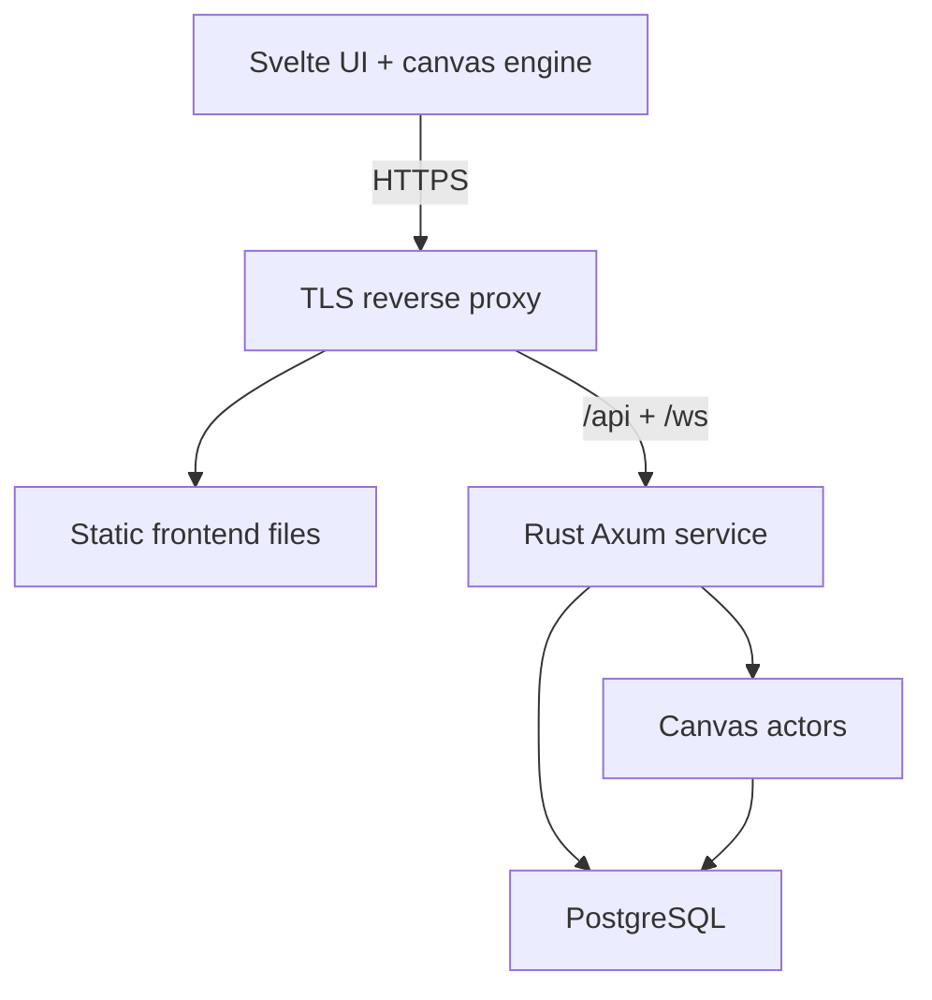

# Architecture

## Current foundation

`apps/web` is a static SvelteKit client. Its local renderer keeps a 512 × 320 indexed buffer and a sparse localStorage edit map. Rust serves health and catalog JSON only. No WebSocket handler, database, account system, or shared placement is implemented yet.

## Target topology for the first public version

Deploy a single Rust instance first. A canvas actor owns its indexed pixel buffer, sequence number, protection mask, subscribers, and short deduplication window. It serializes writes so accepted changes have a clear total order per canvas. Do not introduce multiple writers until ownership, routing, and failover have an explicit design.

## Frontend boundaries

- **Svelte UI:** painting browser, palette, chat, profiles, forms, moderation, and connection feedback.
- **Canvas engine:** transforms, viewport/culling, pixel buffer, dirty regions, hit testing, rendering, export.
- **Realtime client:** typed messages, socket lifecycle, request correlation, snapshot assembly, ordered delta application.
- **Client stores:** authenticated user, active canvas metadata, role/permissions, selected tool, user preferences.

Canvas pixel buffers stay outside Svelte reactive collections. Render on animation frames and coalesce repeated writes to the same pixel for display while preserving authoritative sequence handling. Start with Canvas 2D and a reusable ImageData buffer. Measure before moving to tiled/WebGL rendering.

For a 2048 × 2048 board, raw palette-index storage is 4 MiB; a full RGBA image is 16 MiB. Account for duplicates, browser textures, history, and temporary buffers when measuring actual memory. Limit active board residency. Larger boards and concurrent painting viewers may require chunking.

## Authoritative placement path

1. Client submits request ID, canvas, coordinate, and palette index.
2. Rust validates session, canvas membership, role, bounds, palette, protection, cooldown, and per-user/IP limits.
3. Canvas actor assigns the next sequence number and commits the event plus latest pixel state durably in one database transaction.
4. On commit success, actor mutates its memory buffer and broadcasts the accepted event, including the originating request ID.
5. On database failure, no acceptance is sent. Recover/reload the actor before processing more writes if the commit outcome is ambiguous.

In M1, the development-only actor may operate in memory; it must not claim restart durability. From M2 onward, acknowledgement means committed storage. A retry with a duplicate request ID must return the previous result, not consume another cooldown or create another event.

## Snapshot and reconnect consistency

Capture snapshot version `S` and register the subscriber at the same actor ordering boundary. Then send that snapshot and all accepted events after `S`, in order. Network streaming can happen outside the actor lock, but the captured snapshot must be immutable. Bound the number/bytes of queued events during snapshot transfer.

Clients apply a snapshot atomically, then deltas starting at `S + 1`. Ignore duplicate older deltas. Any gap, malformed payload, queue overflow, expired history window, or epoch mismatch forces a fresh snapshot. Disable placement until synchronization completes. An actor restart generates a new epoch so old sequence numbers cannot be mistaken for new data.

## Database design draft (M2/M3)

| Table | Key fields / purpose |
| --- | --- |
| users | ID, normalized unique handle, avatar reference, timestamps, moderation state |
| identities | Provider + subject unique pair mapped to user ID |
| sessions | Hashed opaque session token, user, expiry, revocation |
| canvases | Owner, dimensions, palette, cooldown, visibility/access policy, rules, template version |
| canvas_members | User + canvas, role/access status, inviter/approver |
| canvas_pixels | Canvas + coordinate unique key; current color, actor, event sequence |
| pixel_events | Canvas + sequence unique key; request ID, coordinate, color, actor, timestamp |
| canvas_snapshots | Canvas, epoch/version, encoded bytes or blob key, checksum, creation time |
| protected_regions | Canvas, bounds/mask reference, role policy, creator |
| chat_messages | Channel, author, body, created/edited/deleted state |
| guilds / guild_members | Guild identity, member roles, invite/access status |
| reports / moderation_actions | Target, reason, reviewer, decision, before/after audit |

This is a schema proposal, not an applied migration. Partition event history only after measuring volume. Decide retention and replay requirements before deleting old events. Latest-state upserts and event insertion must share the durability transaction.

## API surface

| Route | Status | Purpose |
| --- | --- | --- |
| `GET /api/health` | Implemented | Service liveness, version, explicit multiplayer flag |
| `GET /api/canvases` | Implemented stub | Local demo catalog |
| `GET /api/ready` | M2/M5 | Readiness including database connectivity |
| `GET /api/canvases/:id` | M1/M3 | Metadata, palette, mode, effective permissions |
| `GET /ws` | M1 | Canvas subscription, snapshot, placement, presence; chat in M2 |
| `POST /api/canvases` | M3 | Authenticated painting creation |
| `PATCH /api/canvases/:id` | M3 | Owner/moderator configuration |
| `POST /api/reports` | M2/M5 | Content/report submission |
| `GET /api/canvases/:id/export` | M3 | Accepted-state PNG export |

Paths use `:id` as documentation shorthand; Axum 0.8 uses `{id}` in route declarations. Follow `PROTOCOL.md` for planned socket messages. Ordinary business writes stay in Rust rather than duplicating authorization in SvelteKit endpoints.

## Authentication and abuse boundaries

Use a maintained OIDC implementation and server-side opaque sessions. Keep cookies HttpOnly, Secure in production, and SameSite. Check WebSocket Origin against an allowlist and bind the socket to the authenticated session. Do not place credentials in URLs. Re-check live session/role revocation while a connection is open.

Apply bounds at the edge and in the service: message size, chat length, canvas dimensions, palette length, connections, write frequency, queue bytes, subscription count, and request cache size. Zero cooldown means fast drawing within server policy. Protected regions, palette restrictions, and roles are checked for every mutation, including owner tools and imports.

Treat all user text as text, and use a separately validated image-upload pipeline when avatars/templates are added. Audit moderator actions. Provide a canvas freeze and targeted rollback before public beta. Do not publish the unauthenticated local foundation as a public writable service.

## Hosting and scaling path

Build frontend static files and a Rust release binary. Run behind a reverse proxy with WebSocket upgrades and TLS, plus managed or self-hosted PostgreSQL with backups. No provider has been provisioned.

Add object storage for large snapshots/history once database blobs stop being appropriate. Add Redis for cross-instance presence/rate limits/pub-sub only after multiple instances are needed. Multi-instance canvas ownership needs a lease/epoch, durable ordering, and resync on failover; Redis pub-sub alone is not a durable placement log.

## Testing strategy

- Pure tests: transforms, bounds, masks, palette encoding, cooldown/deduplication, permissions.
- Rust HTTP/socket integration tests: malformed packets, unauthorized writes, duplicate IDs, ordering, and queue overflow.
- Database tests: migration from empty schema, transactional recovery, forced crash after commit, snapshot/event replay equivalence.
- Browser tests: two independent sessions, reconnect during snapshot, canvas switch, touch, protected pixel, chat authorization.
- Load/soak tests: measured clients/writes, fan-out bandwidth, slow consumers, memory and latency percentiles.

CI currently configures formatting, frontend type/build checks, engine tests, Rust linting, and Rust tests. Protocol, database, browser, and load suites must be added alongside those features.
